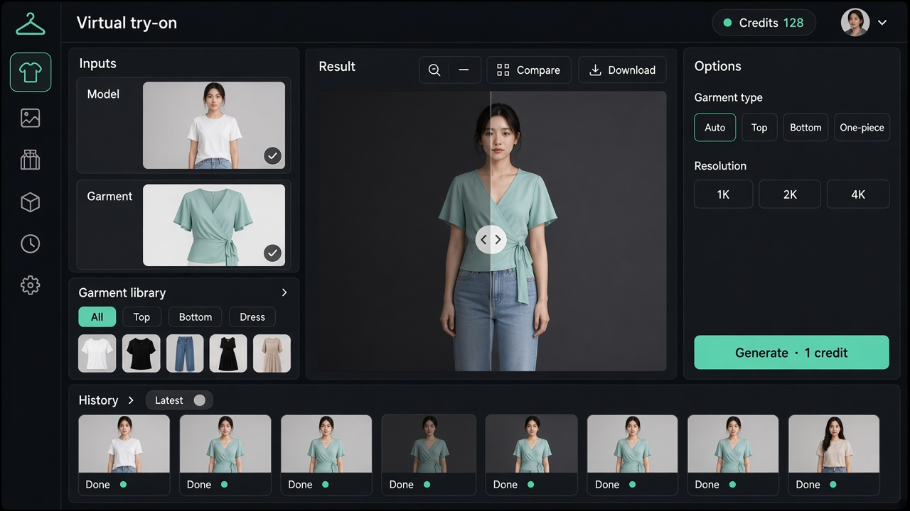
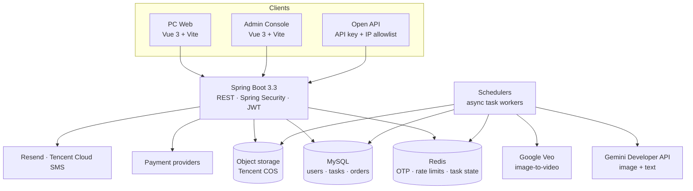

<div align="center">


# FashTry — AI Fashion Content Studio

**Open-source, self-hostable AI virtual try-on and e-commerce content platform.**
Virtual try-on, model shots, e-commerce image packs, outfit videos, AI portraits and more —
built as a production-shaped Spring Boot + Vue monorepo.

[中文文档](README.zh-CN.md) · [Quick start](#quick-start) · [Configuration](#configuration) · [API](#api-overview) · [License](#license)


</div>

---

## Why this project

Most AI try-on demos stop at a single API call. FashTry is the full product around it: async task
queues, credit billing, multi-channel payments, user accounts, an admin console, an open API and
two front-end apps. It is extracted from a live SaaS and open-sourced as a reference
implementation for teams building AI commerce tools.

## Features

| Area | What it does |
| --- | --- |
| **Virtual try-on** | Model photo + garment photo → photorealistic try-on. Single and batch submission, async progress polling. |
| **Model shots** | Turn flat-lay garment photos into on-model shots, with several scenes and a white-background hero image. |
| **E-commerce pack** | Multi-step garment packshot pipeline: on-model, scene variations, white background. |
| **Clothing suite** | One garment image → a consistent set of 10 e-commerce images. |
| **Garment retouch** | Product photo cleanup and enhancement. |
| **Local edit** | Brush/mask editor for local inpainting-style edits. |
| **AI portraits** | Generate portrait sets with configurable output count and credit pricing. |
| **Outfit video** | Image-to-video (Google Veo) from a try-on result, with duration/resolution/aspect options. |
| **XHS card copy** | Xiaohongshu-style social card copywriting from a topic, selling points and audience. |
| **My works** | Unified generation history across task types, plus favorites. |
| **Credits & billing** | Credit wallet, recharge packages, orders, refunds/ledger, referral rewards, registration gifts and abuse guards. |
| **Payments** | WeChat Pay V3 (Native/JSAPI), Alipay, PayPal, Lemon Squeezy and NOWPayments (USDT). Each channel degrades gracefully when unconfigured. |
| **Accounts** | Phone SMS code, email code (Resend), Google OAuth, WeChat Mini Program; JWT access + refresh tokens. |
| **Admin console** | Users, orders, credit ledger, tasks, uploads, feedback, brands, public garment/model libraries, recharge packages, stats, Gemini key pool and registration policies. |
| **Open API** | User-issued API keys, optional IP allowlist, credit-metered AI endpoints. |

### Screenshots

| Virtual try-on | Outfit video |
| --- | --- |
|  |  |

## Architecture



Generation is asynchronous: the API validates the request, charges or reserves credits, inserts a
task row and returns a task ID immediately. A scheduler claims queued tasks, calls the AI provider,
uploads results to object storage and writes the final status back to MySQL/Redis for polling.

## Tech stack

| Layer | Choice |
| --- | --- |
| Backend | Java 17, Spring Boot 3.3, Spring Security, Spring Validation, Spring AOP |
| Persistence | MySQL 5.7+/8.0, MyBatis-Plus 3.5, HikariCP |
| Cache / queue state | Redis (Lettuce) |
| Auth | JWT (jjwt 0.12), Google OAuth 2.0, WeChat Mini Program |
| AI | Google Gemini Developer API (image + text), Google Veo (image-to-video), optional FASHN client |
| Storage | Tencent Cloud COS |
| Payments | WeChat Pay V3, Alipay, PayPal, Lemon Squeezy, NOWPayments |
| Messaging | Resend (email), Tencent Cloud SMS |
| Frontend | Vue 3.5, Vue Router 4, Vite 6 |

## Repository layout

```text
.
├── src/main/java/com/fashtry/backend
│   ├── bean/            # Entities, DTOs, VOs
│   ├── common/          # Config, response envelope, exceptions, enums
│   ├── controller/      # business / admin / open / public endpoints
│   ├── mapper/          # MyBatis-Plus mappers
│   ├── pay/             # WeChat Pay, Alipay, PayPal, Lemon Squeezy, NOWPayments
│   ├── security/        # JWT filter, Spring Security configuration
│   ├── service/         # Business services, AI clients, storage, prompts
│   ├── task/            # Async schedulers
│   └── utils/
├── src/main/resources
│   ├── application.yml              # Shared configuration (env-var driven)
│   ├── application-dev.yml          # Local development defaults
│   ├── application-pro.yml.example  # Production template
│   ├── mapper/                      # XML mappers
│   └── sql/schema.sql               # Full database schema (no data)
├── web
│   ├── src/             # PC web app
│   ├── admin/           # Admin console
│   └── public/          # Shared static assets
└── docker-compose.yml   # MySQL + Redis for local development
```

## Quick start

### Requirements

- JDK 17+
- Maven 3.8+
- Node.js 18+
- Docker (optional, for MySQL and Redis)

### 1. Start dependencies

```bash
docker compose up -d
```

This starts MySQL 8 on `3306` (database `fash_try`, user/password `fash_try`/`fash_try`) and Redis on
`6379`, and imports `src/main/resources/sql/schema.sql` on first boot.

> Already have MySQL/Redis? Create a database and run `src/main/resources/sql/schema.sql` manually.

### 2. Start the backend

```bash
mvn spring-boot:run
```

The API listens on `http://localhost:18888`. The default profile is `dev`, which points at the local
MySQL/Redis above.

On first start an admin account is created. Set `ADMIN_PASSWORD`, or leave it empty and copy the
generated password printed once in the log:

```text
WARN  c.f.backend.config.AdminUserInitializer - Created admin account 'admin' with generated password: ...
```

### 3. Start the frontends

```bash
cd web
npm install

# PC site → http://localhost:5173
npm run dev

# Admin console → http://localhost:5174/admin0522/
npm run dev:admin
```

Vite proxies `/api` to `http://127.0.0.1:18888` by default. Copy `web/.env.example` to
`web/.env.local` if you need a different backend target.

### 4. Enable AI features

Set `GEMINI_API_KEY` before starting the backend, or sign in to the admin console and add one or more
keys under **Gemini Keys** (the key pool supports round-robin / failover / random strategies).

> Sign-in requires at least one delivery channel: `RESEND_API_KEY` for email codes, Tencent Cloud SMS
> credentials for phone codes, or Google OAuth credentials. See the table below.

## Configuration

All configuration is environment-variable driven. `application.yml` contains shared settings,
`application-dev.yml` contains local defaults, and `application-pro.yml.example` is the production
template (copy it to `application-pro.yml`, which is git-ignored).

### Core

| Variable | Default | Description |
| --- | --- | --- |
| `SERVER_PORT` | `18888` | Backend HTTP port |
| `SPRING_PROFILES_ACTIVE` | `dev` | `dev` or `pro` |
| `DB_HOST` / `DB_PORT` / `DB_NAME` | `127.0.0.1` / `3306` / `fash_try` | MySQL connection |
| `DB_USERNAME` / `DB_PASSWORD` | `fash_try` / `fash_try` | MySQL credentials |
| `REDIS_HOST` / `REDIS_PORT` | `127.0.0.1` / `6379` | Redis connection |
| `REDIS_PASSWORD` / `REDIS_DATABASE` | empty / `0` | Redis auth and database index |
| `JWT_SECRET` | dev placeholder | **Change in production.** HS256 needs 32+ bytes |
| `ADMIN_USERNAME` / `ADMIN_PASSWORD` | `admin` / empty | Bootstrap admin account |
| `APP_BASE_URL` | `http://localhost:18888` | Public backend URL (callbacks, OAuth redirects) |
| `FRONTEND_BASE_URL` | `http://localhost:5173` | Public frontend URL |
| `CORS_ALLOWED_ORIGINS` | localhost origins | Comma-separated allowed origins |
| `FREE_TRIAL_CREDITS` / `DAILY_GIFT_TOTAL_CREDITS` | `1` / `20` | Registration credit policy defaults |

### AI

| Variable | Description |
| --- | --- |
| `GEMINI_API_KEY` | Google AI Studio key; can also be managed from the admin key pool |
| `GEMINI_ENABLED` | Enable the Gemini client (`true` by default) |
| `GEMINI_IMAGE_MODEL` / `GEMINI_TEXT_MODEL` | Image and text model IDs |
| `FASHN_API_KEY` | Optional legacy FASHN provider |

### Storage, messaging and auth

| Variable | Description |
| --- | --- |
| `COS_SECRET_ID` / `COS_SECRET_KEY` | Tencent Cloud COS credentials |
| `COS_REGION` / `COS_BUCKET` / `COS_DOMAIN` | Bucket location and public domain |
| `RESEND_API_KEY` / `RESEND_FROM` | Email verification codes |
| `SMS_SECRET_ID` / `SMS_SECRET_KEY` / `SMS_SDK_APP_ID` | Tencent Cloud SMS |
| `SMS_SIGN_NAME` / `SMS_TEMPLATE_ID` / `SMS_TEMPLATE_ID_INTL` | SMS templates |
| `GOOGLE_CLIENT_ID` / `GOOGLE_CLIENT_SECRET` | Google OAuth login |
| `WX_MINI_APP_ID` / `WX_MINI_SECRET` | WeChat Mini Program login |

### Payments

| Variable | Description |
| --- | --- |
| `WX_PAY_APP_ID` / `WX_PAY_MCH_ID` / `WX_PAY_CERT_SERIAL_NO` | WeChat Pay V3 merchant config |
| `WX_PAY_PRIVATE_KEY_PATH` / `WX_PAY_PLATFORM_CERT_PATH` | Paths to merchant private key and platform certificate (never commit them) |
| `ALIPAY_APP_ID` / `ALIPAY_PRIVATE_KEY` / `ALIPAY_PUBLIC_KEY` | Alipay app credentials |
| `PAYPAL_CLIENT_ID` / `PAYPAL_CLIENT_SECRET` / `PAYPAL_BASE_URL` | PayPal REST API |
| `LEMON_SQUEEZY_STORE_ID` / `LEMON_SQUEEZY_API_KEY` | Lemon Squeezy checkout |
| `LEMON_SQUEEZY_CHECKOUT_BASE_URL` / `LEMON_SQUEEZY_WEBHOOK_SECRET` | Checkout URL and webhook signature |
| `NOWPAYMENTS_API_KEY` / `NOWPAYMENTS_IPN_SECRET` | USDT (TRC20/BSC) payments |

Payment, email and SMS features return a clear "not configured" error until their credentials are
provided; the rest of the application keeps working.

## API overview

All responses use a `{ code, message, data }` envelope. Authenticated endpoints expect
`Authorization: Bearer <accessToken>`.

| Group | Base path | Notes |
| --- | --- | --- |
| Auth | `/api/auth` | Captcha, SMS/email codes, phone/email/Google/WeChat login, refresh |
| User | `/api/user` | Profile, API keys |
| Upload | `/api/upload` | Uploads to object storage |
| Try-on | `/api/tryon` | Single/batch submit, status polling, history |
| Product to model | `/api/product-to-model` | Async garment-to-model pipeline |
| Image edit | `/api/image-edit` | Local edit with masks |
| Packshot | `/api/clothing-packshot` | Model shots with scenes |
| Clothing suite | `/api/clothing-product-suite` | 10-image consistent suite |
| Retouch | `/api/product-retouch` | Garment/product retouch |
| Portrait | `/api/portrait-studio` | AI portrait generation |
| Outfit video | `/api/model-video` | Veo image-to-video |
| XHS card | `/api/xhs-card` | Social card copywriting |
| Billing | `/api/recharge`, `/api/pay/notify/*` | Packages, orders, payment callbacks |
| Favorites / works | `/api/favorites`, `/api/mobile/task-history` | Unified history and favorites |
| Public | `/api/public` | Public garment/model libraries, brand entry, feedback |
| Open API | `/api/open/ai` | API-key authenticated, credit-metered |
| Admin | `/api/admin` | Everything the console needs |

## Deployment

```bash
# Backend
mvn -DskipTests package
java -jar target/fash-try.jar --spring.profiles.active=pro

# Web
cd web
npm ci && npm run build
npm run build:admin
```

Serve `web/dist` at `/` and `web/dist-admin0522` at `/admin0522/`, and reverse-proxy `/api` to the
backend. Terminate TLS at the proxy and keep payment/email webhook paths publicly reachable.

## Security

- This repository contains **no credentials**. Real values live only in environment variables or
  the git-ignored `application-pro.yml`.
- `src/main/resources/WEB-INF/` (payment certificates and private keys) is git-ignored. Never commit
  `*.pem`, `*.p12` or API keys.
- If you forked an earlier version of this project or copied configuration from an internal branch,
  **rotate every credential** that was ever committed: database passwords, cloud access keys,
  payment merchant keys, AI provider keys, email/SMS keys and `JWT_SECRET`.
- The bootstrap admin password is printed once. Change it immediately after first login.
- Please report vulnerabilities according to [SECURITY.md](SECURITY.md).

## Known limitations

- No test suite yet; contributions adding integration tests are welcome.
- Schema changes are plain SQL files under `src/main/resources/sql/`; no migration runner is wired in.
- The bundled FASHN client is kept for compatibility; Gemini is the primary provider.
- SMS/email delivery providers are region-specific and must be configured before use.

## Contributing

Bug reports, docs fixes and pull requests are welcome. Please read [CONTRIBUTING.md](CONTRIBUTING.md)
first.

## License

[MIT](LICENSE) © 2026 FashTry
