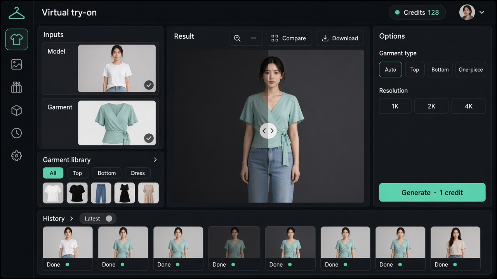
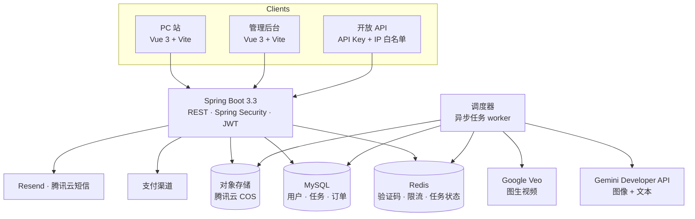

<div align="center">


# FashTry — AI 服装内容工作台

**可私有化部署的开源 AI 虚拟试穿与电商内容平台。**
虚拟试穿、模特出图、电商套图、穿搭视频、AI 写真等能力，以 Spring Boot + Vue 单体仓库的形式开源。

[](https://openjdk.org/)
[](https://spring.io/projects/spring-boot)
[](https://vuejs.org/)
[](LICENSE)

**在线演示：** [fashtry.com](https://fashtry.com)

[English](README.md) · [快速开始](#快速开始) · [配置](#配置) · [接口](#接口概览) · [许可证](#许可证)


</div>

---

## 项目定位

多数 AI 试穿项目只做到一次模型调用，FashTry 提供的是完整产品形态：异步任务队列、点数计费、多渠道支付、
用户体系、管理后台、开放 API 和两套前端。代码抽离自线上 SaaS，可作为 AI 电商工具的生产级参考实现。

## 功能

| 模块 | 说明 |
| --- | --- |
| **虚拟试穿** | 模特图 + 服装图生成上身效果，支持单张与批量提交、异步进度轮询 |
| **模特出图** | 平铺服装图 → 模特上身，支持多场景与白底主图 |
| **电商套图** | 多步骤模特图流水线：上身、场景变化、白底主图 |
| **服装套图** | 单张服装图生成 10 张风格一致的电商图 |
| **服装精修** | 商品图清理与增强 |
| **局部改款** | 画笔/蒙版方式的局部重绘 |
| **AI 写真** | 可配置张数与点数的写真生成 |
| **穿搭视频** | 基于 Google Veo 的图生视频，支持时长/分辨率/比例选项 |
| **小红书卡片** | 根据主题、卖点、受众生成社交卡片文案 |
| **我的作品** | 跨任务类型的统一生成历史与收藏 |
| **点数与计费** | 点数钱包、充值套餐、订单、流水、邀请奖励、注册赠送与风控 |
| **支付** | 微信支付 V3（Native/JSAPI）、支付宝、PayPal、Lemon Squeezy、NOWPayments（USDT）；未配置时自动降级 |
| **账号体系** | 手机短信验证码、邮箱验证码（Resend）、Google OAuth、微信小程序；JWT access + refresh |
| **管理后台** | 用户、订单、点数流水、任务、上传记录、反馈、品牌、公共服装/模特库、充值套餐、统计、Gemini Key 池、注册策略 |
| **开放 API** | 用户自助 API Key、可选 IP 白名单、按点数计费的 AI 接口 |

### 界面截图

| 虚拟试穿 | 穿搭视频 |
| --- | --- |
|  |  |

## 架构



生成流程是异步的：接口校验参数、校验或预扣点数、写入任务表后立即返回任务 ID；调度器领取排队任务，
调用 AI 服务、上传结果到对象存储，并把最终状态写回 MySQL/Redis 供前端轮询。

## 技术栈

| 层次 | 选型 |
| --- | --- |
| 后端 | Java 17、Spring Boot 3.3、Spring Security、Spring Validation、Spring AOP |
| 存储 | MySQL 5.7+/8.0、MyBatis-Plus 3.5、HikariCP |
| 缓存/队列状态 | Redis（Lettuce） |
| 认证 | JWT（jjwt 0.12）、Google OAuth 2.0、微信小程序 |
| AI | Google Gemini Developer API（图像 + 文本）、Google Veo（图生视频）、可选 FASHN 客户端 |
| 对象存储 | 腾讯云 COS |
| 支付 | 微信支付 V3、支付宝、PayPal、Lemon Squeezy、NOWPayments |
| 消息 | Resend（邮件）、腾讯云短信 |
| 前端 | Vue 3.5、Vue Router 4、Vite 6 |

## 目录结构

```text
.
├── src/main/java/com/fashtry/backend
│   ├── bean/            # 实体、DTO、VO
│   ├── common/          # 配置、统一返回、异常、枚举
│   ├── controller/      # business / admin / open / public 接口
│   ├── mapper/          # MyBatis-Plus Mapper
│   ├── pay/             # 微信、支付宝、PayPal、Lemon Squeezy、NOWPayments
│   ├── security/        # JWT 过滤器与 Spring Security 配置
│   ├── service/         # 业务服务、AI 客户端、存储、提示词
│   ├── task/            # 异步调度器
│   └── utils/
├── src/main/resources
│   ├── application.yml              # 公共配置（环境变量驱动）
│   ├── application-dev.yml          # 本地开发默认值
│   ├── application-pro.yml.example  # 生产配置模板
│   ├── mapper/                      # XML Mapper
│   └── sql/schema.sql               # 完整表结构（不含数据）
├── web
│   ├── src/             # PC 站
│   ├── admin/           # 管理后台
│   └── public/          # 公共静态资源
└── docker-compose.yml   # 本地 MySQL + Redis
```

## 快速开始

### 环境要求

- JDK 17+
- Maven 3.8+
- Node.js 18+
- Docker（可选，用于启动 MySQL 和 Redis）

### 1. 启动依赖服务

```bash
docker compose up -d
```

会启动 MySQL 8（`3306`，库 `fash_try`，账号密码 `fash_try`/`fash_try`）和 Redis（`6379`），
并在首次启动时自动导入 `src/main/resources/sql/schema.sql`。

> 已有 MySQL/Redis？手动建库并执行 `src/main/resources/sql/schema.sql` 即可。

### 2. 启动后端

```bash
mvn spring-boot:run
```

接口地址为 `http://localhost:18888`，默认 `dev` 环境，连接上面的本地 MySQL/Redis。

首次启动会自动创建管理员账号。建议设置 `ADMIN_PASSWORD`；留空则随机生成一次密码并打印在日志中：

```text
WARN  c.f.backend.config.AdminUserInitializer - Created admin account 'admin' with generated password: ...
```

### 3. 启动前端

```bash
cd web
npm install

# PC 站 → http://localhost:5173
npm run dev

# 管理后台 → http://localhost:5174/admin0522/
npm run dev:admin
```

Vite 默认把 `/api` 代理到 `http://127.0.0.1:18888`。如需修改，复制 `web/.env.example` 为
`web/.env.local` 并调整 `VITE_PROXY_TARGET`。

### 4. 启用 AI 能力

启动前设置 `GEMINI_API_KEY`，或登录管理后台，在「Gemini Keys」中添加一把或多把 Key
（Key 池支持轮询 / 故障转移 / 随机策略）。

> 登录需要至少配置一种验证码通道：邮箱验证码需要 `RESEND_API_KEY`，手机验证码需要腾讯云短信配置，
> 或配置 Google OAuth。详见下方配置表。

## 配置

所有配置均由环境变量驱动。`application.yml` 放公共配置，`application-dev.yml` 放本地默认值，
`application-pro.yml.example` 是生产模板（复制为 `application-pro.yml`，该文件已在 `.gitignore` 中）。

### 基础

| 变量 | 默认值 | 说明 |
| --- | --- | --- |
| `SERVER_PORT` | `18888` | 后端端口 |
| `SPRING_PROFILES_ACTIVE` | `dev` | `dev` 或 `pro` |
| `DB_HOST` / `DB_PORT` / `DB_NAME` | `127.0.0.1` / `3306` / `fash_try` | MySQL 连接 |
| `DB_USERNAME` / `DB_PASSWORD` | `fash_try` / `fash_try` | MySQL 账号 |
| `REDIS_HOST` / `REDIS_PORT` | `127.0.0.1` / `6379` | Redis 连接 |
| `REDIS_PASSWORD` / `REDIS_DATABASE` | 空 / `0` | Redis 密码与库号 |
| `JWT_SECRET` | 开发占位值 | **生产必须更换**，HS256 至少 32 字节 |
| `ADMIN_USERNAME` / `ADMIN_PASSWORD` | `admin` / 空 | 初始化管理员 |
| `APP_BASE_URL` | `http://localhost:18888` | 后端公网地址（回调、OAuth 跳转） |
| `FRONTEND_BASE_URL` | `http://localhost:5173` | 前端公网地址 |
| `CORS_ALLOWED_ORIGINS` | 本地地址 | 逗号分隔的允许来源 |
| `FREE_TRIAL_CREDITS` / `DAILY_GIFT_TOTAL_CREDITS` | `1` / `20` | 注册赠送默认策略 |

### AI

| 变量 | 说明 |
| --- | --- |
| `GEMINI_API_KEY` | Google AI Studio Key，也可在后台 Key 池管理 |
| `GEMINI_ENABLED` | 是否启用 Gemini 客户端（默认 `true`） |
| `GEMINI_IMAGE_MODEL` / `GEMINI_TEXT_MODEL` | 图像/文本模型 ID |
| `FASHN_API_KEY` | 可选的旧版 FASHN 供应商 |

### 存储、消息与登录

| 变量 | 说明 |
| --- | --- |
| `COS_SECRET_ID` / `COS_SECRET_KEY` | 腾讯云 COS 密钥 |
| `COS_REGION` / `COS_BUCKET` / `COS_DOMAIN` | 存储桶地域、名称、访问域名 |
| `RESEND_API_KEY` / `RESEND_FROM` | 邮箱验证码 |
| `SMS_SECRET_ID` / `SMS_SECRET_KEY` / `SMS_SDK_APP_ID` | 腾讯云短信 |
| `SMS_SIGN_NAME` / `SMS_TEMPLATE_ID` / `SMS_TEMPLATE_ID_INTL` | 短信签名与模板 |
| `GOOGLE_CLIENT_ID` / `GOOGLE_CLIENT_SECRET` | Google OAuth 登录 |
| `WX_MINI_APP_ID` / `WX_MINI_SECRET` | 微信小程序登录 |

### 支付

| 变量 | 说明 |
| --- | --- |
| `WX_PAY_APP_ID` / `WX_PAY_MCH_ID` / `WX_PAY_CERT_SERIAL_NO` | 微信支付 V3 商户配置 |
| `WX_PAY_PRIVATE_KEY_PATH` / `WX_PAY_PLATFORM_CERT_PATH` | 商户私钥与平台证书路径（切勿提交仓库） |
| `ALIPAY_APP_ID` / `ALIPAY_PRIVATE_KEY` / `ALIPAY_PUBLIC_KEY` | 支付宝应用配置 |
| `PAYPAL_CLIENT_ID` / `PAYPAL_CLIENT_SECRET` / `PAYPAL_BASE_URL` | PayPal REST API |
| `LEMON_SQUEEZY_STORE_ID` / `LEMON_SQUEEZY_API_KEY` | Lemon Squeezy 结账 |
| `LEMON_SQUEEZY_CHECKOUT_BASE_URL` / `LEMON_SQUEEZY_WEBHOOK_SECRET` | 结账地址与 Webhook 签名 |
| `NOWPAYMENTS_API_KEY` / `NOWPAYMENTS_IPN_SECRET` | USDT（TRC20/BSC）支付 |

支付、邮件、短信在未配置时会返回明确的"未配置"错误，不影响其他功能。

## 接口概览

所有接口统一返回 `{ code, message, data }`；需要登录的接口携带
`Authorization: Bearer <accessToken>`。

| 分组 | 基础路径 | 说明 |
| --- | --- | --- |
| 认证 | `/api/auth` | 图形验证码、短信/邮箱验证码、手机/邮箱/Google/微信登录、刷新 token |
| 用户 | `/api/user` | 资料、API Key |
| 上传 | `/api/upload` | 上传到对象存储 |
| 试穿 | `/api/tryon` | 单张/批量提交、状态轮询、历史 |
| 服装转模特 | `/api/product-to-model` | 异步服装图 → 模特图 |
| 局部改款 | `/api/image-edit` | 蒙版局部编辑 |
| 模特出图 | `/api/clothing-packshot` | 多场景模特图 |
| 服装套图 | `/api/clothing-product-suite` | 10 张一致风格套图 |
| 商品精修 | `/api/product-retouch` | 服装/商品图精修 |
| AI 写真 | `/api/portrait-studio` | 写真生成 |
| 穿搭视频 | `/api/model-video` | Veo 图生视频 |
| 小红书卡片 | `/api/xhs-card` | 社交卡片文案 |
| 计费 | `/api/recharge`、`/api/pay/notify/*` | 套餐、订单、支付回调 |
| 收藏/作品 | `/api/favorites`、`/api/mobile/task-history` | 统一历史与收藏 |
| 公共 | `/api/public` | 公共服装/模特库、品牌进店、反馈 |
| 开放 API | `/api/open/ai` | API Key 认证、按点数计费 |
| 管理后台 | `/api/admin` | 后台所需的全部接口 |

## 部署

```bash
# 后端
mvn -DskipTests package
java -jar target/fash-try.jar --spring.profiles.active=pro

# PC 站
cd web
npm ci && npm run build
npm run build:admin
```

将 `web/dist` 部署到 `/`、`web/dist-admin0522` 部署到 `/admin0522/`，并把 `/api` 反向代理到后端。
TLS 在网关层终止，支付与邮件 Webhook 路径需公网可达。

## 安全说明

- 本仓库**不包含任何凭据**。真实值只放在环境变量或已被 git 忽略的 `application-pro.yml` 中。
- `src/main/resources/WEB-INF/`（支付证书与商户私钥）已被 git 忽略。切勿提交 `*.pem`、`*.p12`
  或任何 API Key。
- 如果你 fork 过本项目的早期版本，或从内部分支复制过配置，请**轮换所有曾经提交过的凭据**：
  数据库密码、云厂商 AK、支付商户密钥、AI Key、邮件/短信 Key 以及 `JWT_SECRET`。
- 初始化管理员密码只在日志中打印一次，请首次登录后立即修改。
- 漏洞报告请参照 [SECURITY.md](SECURITY.md)。

## 已知限制

- 暂无自动化测试，欢迎补充集成测试。
- 表结构变更以 `src/main/resources/sql/` 下的 SQL 文件维护，尚未接入迁移工具。
- 保留 FASHN 客户端用于兼容，主要供应商为 Gemini。
- 短信/邮件通道有地域限制，使用前需自行配置。

## Roadmap

- [ ] 点数账本、任务状态机、支付回调的自动化测试
- [ ] 一条命令启动的 Docker Compose 全栈（后端 + 前端 + 依赖）
- [ ] 接入 Flyway 或 Liquibase，支持存量库升级
- [ ] 通过统一适配层接入更多 AI 供应商（OpenAI、Flux、ComfyUI）
- [ ] 管理后台国际化

## 参与贡献

欢迎提交 Issue 和 PR，请先阅读 [CONTRIBUTING.md](CONTRIBUTING.md)。如果这个项目对你有帮助，点个 Star 能让更多人看到它。

## 许可证

[MIT](LICENSE) © 2026 FashTry
